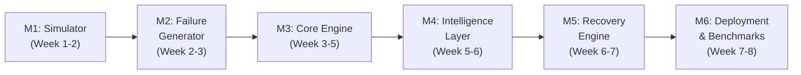

# Invariant — Technical Roadmap
### Business Transaction Integrity & Recovery Platform
> **Target Role:** Forward Deployed Engineer Intern 2027, Google Cloud Consulting

---

> [!IMPORTANT]
> **The project name is load-bearing.** An *invariant* in distributed systems is a property that must hold true across all system states. `Invariant` enforces that business-level invariants — "every captured payment must have a corresponding ERP record," "subscription cancellation must revoke access" — are never silently violated. The name communicates the entire thesis in one word.

---

## Table of Contents
1. [System Overview & Design Philosophy](#1-system-overview--design-philosophy)
2. [Data Model & Database Schemas](#2-data-model--database-schemas)
3. [Event Contract Specification](#3-event-contract-specification)
4. [Core Engine Architecture](#4-core-engine-architecture)
5. [Multi-Agent System Design (ADK)](#5-multi-agent-system-design-adk)
6. [RAG & Knowledge Architecture](#6-rag--knowledge-architecture)
7. [Recovery Engine & Saga Orchestration](#7-recovery-engine--saga-orchestration)
8. [Simulated Business Services](#8-simulated-business-services)
9. [Failure Scenario Catalog](#9-failure-scenario-catalog)
10. [Google Cloud Deployment Architecture](#10-google-cloud-deployment-architecture)
11. [Observability & LLM Metrics](#11-observability--llm-metrics)
12. [Evaluation Framework & Benchmarks](#12-evaluation-framework--benchmarks)
13. [Milestone Plan](#13-milestone-plan)
14. [FDE Alignment Matrix](#14-fde-alignment-matrix)

---

## 1. System Overview & Design Philosophy

### 1.1 Core Thesis

```
Traditional monitoring asks: "Did the API return 200?"
Invariant asks:              "Is the business in the correct state?"
```

A transaction is not complete because five HTTP calls returned 200. It is complete when five systems have independently confirmed the correct business state, and those confirmations are internally consistent.

### 1.2 Layered Architecture Philosophy

```
┌─────────────────────────────────────────────────────────┐
│                   INTELLIGENCE LAYER                    │
│         Google ADK · Gemini · RAG · pgvector            │
├─────────────────────────────────────────────────────────┤
│                   INTEGRITY LAYER                       │
│    Transaction State Engine · Reconciliation Engine     │
├─────────────────────────────────────────────────────────┤
│                   INGESTION LAYER                       │
│    Webhook Receiver · Pub/Sub · Normalization           │
├─────────────────────────────────────────────────────────┤
│                  CONNECTOR LAYER                        │
│    Shopify · Razorpay · ERP · Inventory · Shipping      │
└─────────────────────────────────────────────────────────┘
```

**Design Rule:** Every lower layer must function without the layer above it. The Integrity Layer must detect inconsistencies even if Gemini is unavailable. The Ingestion Layer must accept and store events even if the Integrity Layer is backlogged. This is not a demo — it is an engineering system.

### 1.3 Key Distributed Systems Concepts Implemented

| Concept | Where Invariant Implements It |
|---|---|
| **Saga Pattern** | Recovery Engine (compensating transactions) |
| **Transactional Outbox** | Connector layer writes events before actions |
| **Idempotency Keys** | Event deduplication, recovery action gating |
| **Event Sourcing** | Immutable `events` table as system of record |
| **CQRS** | Write path (ingestion) separated from read path (UI/investigation) |
| **Eventual Consistency** | Reconciliation scheduler closes gaps between event-driven + poll-based detection |
| **Dead Letter Queue** | Pub/Sub DLQ for unprocessable events |
| **Distributed Tracing** | OpenTelemetry trace propagation across all services |

---

## 2. Data Model & Database Schemas

> [!NOTE]
> PostgreSQL (Cloud SQL) is the primary store. All tables use UUID primary keys and `TIMESTAMPTZ` for all temporal fields. `created_at` is always set by the database via `DEFAULT NOW()`, never trusted from external payloads.

### 2.1 Core Transaction Record

```sql
-- The canonical identity of a business transaction
CREATE TABLE transactions (
    id              UUID PRIMARY KEY DEFAULT gen_random_uuid(),
    tenant_id       UUID NOT NULL REFERENCES tenants(id),
    workflow_id     UUID NOT NULL REFERENCES workflow_definitions(id),
    
    -- Human-readable reference
    reference_code  TEXT NOT NULL,  -- e.g., "TXN-1042"
    
    -- Lifecycle state: machine-enforced via CHECK constraint
    state           TEXT NOT NULL DEFAULT 'INITIATED'
                    CHECK (state IN (
                        'INITIATED', 'IN_PROGRESS', 'COMPLETED',
                        'INCONSISTENT', 'RECOVERING', 'FAILED',
                        'CANCELLED', 'COMPENSATED'
                    )),
    
    -- Business metadata (JSONB for flexibility across workflow types)
    context         JSONB NOT NULL DEFAULT '{}',
    
    -- SLA tracking
    expected_completion_at  TIMESTAMPTZ,
    completed_at            TIMESTAMPTZ,
    
    -- Audit
    created_at      TIMESTAMPTZ NOT NULL DEFAULT NOW(),
    updated_at      TIMESTAMPTZ NOT NULL DEFAULT NOW(),
    version         BIGINT NOT NULL DEFAULT 1  -- Optimistic locking
);

CREATE INDEX idx_transactions_tenant_state ON transactions(tenant_id, state);
CREATE INDEX idx_transactions_reference    ON transactions(reference_code);
CREATE INDEX idx_transactions_created      ON transactions(created_at DESC);
```

### 2.2 Entity Identity Mapping

```sql
-- Correlates external system IDs to a canonical transaction
-- This solves the "Shopify calls it order_id, Razorpay calls it payment_id" problem
CREATE TABLE entity_references (
    id              UUID PRIMARY KEY DEFAULT gen_random_uuid(),
    transaction_id  UUID NOT NULL REFERENCES transactions(id) ON DELETE CASCADE,
    
    system_name     TEXT NOT NULL,   -- e.g., "shopify", "razorpay", "erp"
    entity_type     TEXT NOT NULL,   -- e.g., "order", "payment", "sales_order"
    external_id     TEXT NOT NULL,   -- e.g., "ORD-1042", "PAY-8831"
    
    -- Optional snapshot of the entity at the time of correlation
    entity_snapshot JSONB,
    
    -- Confidence of the mapping (1.0 = deterministic ID match, <1.0 = heuristic)
    confidence      NUMERIC(4,3) NOT NULL DEFAULT 1.000
                    CHECK (confidence BETWEEN 0 AND 1),
    mapping_method  TEXT NOT NULL 
                    CHECK (mapping_method IN ('EXPLICIT_ID', 'RULE_BASED', 'MANUAL')),
    
    created_at      TIMESTAMPTZ NOT NULL DEFAULT NOW(),
    
    UNIQUE (system_name, entity_type, external_id)
);

CREATE INDEX idx_entity_refs_transaction ON entity_references(transaction_id);
CREATE INDEX idx_entity_refs_lookup      ON entity_references(system_name, external_id);
```

### 2.3 Immutable Event Log (System of Record)

```sql
-- Append-only. Never update or delete rows in this table.
CREATE TABLE ingested_events (
    id              UUID PRIMARY KEY DEFAULT gen_random_uuid(),
    tenant_id       UUID NOT NULL REFERENCES tenants(id),
    
    -- Deduplication
    idempotency_key TEXT NOT NULL,   -- Derived from source + source_event_id
    
    -- Source
    source_system   TEXT NOT NULL,   -- e.g., "razorpay"
    source_event_id TEXT NOT NULL,   -- The ID from the originating system
    event_type      TEXT NOT NULL,   -- Canonical event type (after normalization)
    raw_event_type  TEXT NOT NULL,   -- Original event type string from source
    
    -- Payload (both raw and normalized)
    raw_payload     JSONB NOT NULL,  -- Exact bytes received, never mutated
    canonical_payload JSONB NOT NULL, -- Normalized canonical form
    
    -- Timing (CRITICAL: these are different things)
    occurred_at     TIMESTAMPTZ NOT NULL,  -- When the event happened (from source)
    ingested_at     TIMESTAMPTZ NOT NULL DEFAULT NOW(),  -- When we received it
    
    -- Correlation result
    transaction_id  UUID REFERENCES transactions(id),
    correlation_confidence NUMERIC(4,3),
    
    -- Processing state
    processing_state TEXT NOT NULL DEFAULT 'PENDING'
                     CHECK (processing_state IN (
                         'PENDING', 'CORRELATED', 'PROCESSED',
                         'UNRESOLVABLE', 'DEAD_LETTERED'
                     )),
    
    -- Signature verification
    signature_verified  BOOLEAN NOT NULL DEFAULT FALSE,
    signature_header    TEXT,
    
    -- Pub/Sub metadata
    pubsub_message_id   TEXT,
    pubsub_subscription TEXT,
    
    UNIQUE (idempotency_key)  -- Database-level dedup guarantee
);

CREATE INDEX idx_events_transaction      ON ingested_events(transaction_id);
CREATE INDEX idx_events_source_type      ON ingested_events(source_system, event_type);
CREATE INDEX idx_events_ingested_at      ON ingested_events(ingested_at DESC);
CREATE INDEX idx_events_processing_state ON ingested_events(processing_state)
    WHERE processing_state IN ('PENDING', 'UNRESOLVABLE');
```

### 2.4 Transaction Step State

```sql
-- Tracks the state of each expected step within a transaction
CREATE TABLE transaction_steps (
    id              UUID PRIMARY KEY DEFAULT gen_random_uuid(),
    transaction_id  UUID NOT NULL REFERENCES transactions(id) ON DELETE CASCADE,
    
    -- Step definition (from workflow definition)
    step_key        TEXT NOT NULL,   -- e.g., "payment_captured", "erp_order_created"
    step_order      INTEGER NOT NULL,
    
    -- State
    state           TEXT NOT NULL DEFAULT 'PENDING'
                    CHECK (state IN (
                        'PENDING', 'COMPLETED', 'SKIPPED',
                        'FAILED', 'COMPENSATED', 'TIMED_OUT'
                    )),
    
    -- Evidence linking this step to an event
    triggering_event_id UUID REFERENCES ingested_events(id),
    
    -- Data recorded when step completed
    step_data       JSONB,
    
    -- Validation results
    validations     JSONB,  -- Array of {rule, passed, detail}
    
    -- Timing
    expected_by     TIMESTAMPTZ,  -- SLA deadline
    completed_at    TIMESTAMPTZ,
    created_at      TIMESTAMPTZ NOT NULL DEFAULT NOW(),
    updated_at      TIMESTAMPTZ NOT NULL DEFAULT NOW(),
    
    UNIQUE (transaction_id, step_key)
);

CREATE INDEX idx_steps_transaction ON transaction_steps(transaction_id);
CREATE INDEX idx_steps_timed_out   ON transaction_steps(expected_by)
    WHERE state = 'PENDING';
```

### 2.5 Incidents & Investigations

```sql
CREATE TABLE incidents (
    id              UUID PRIMARY KEY DEFAULT gen_random_uuid(),
    tenant_id       UUID NOT NULL REFERENCES tenants(id),
    transaction_id  UUID REFERENCES transactions(id),
    
    -- Classification
    incident_type   TEXT NOT NULL
                    CHECK (incident_type IN (
                        'MISSING_STEP', 'DUPLICATE_EVENT', 'DATA_MISMATCH',
                        'ORDERING_VIOLATION', 'SLA_BREACH', 'ORPHAN_RECORD',
                        'SCHEMA_DRIFT', 'SILENT_FAILURE', 'UNRESOLVABLE'
                    )),
    severity        TEXT NOT NULL DEFAULT 'MEDIUM'
                    CHECK (severity IN ('CRITICAL', 'HIGH', 'MEDIUM', 'LOW')),
    
    state           TEXT NOT NULL DEFAULT 'OPEN'
                    CHECK (state IN (
                        'OPEN', 'INVESTIGATING', 'RECOVERY_PROPOSED',
                        'RECOVERY_APPROVED', 'RECOVERING', 'RESOLVED',
                        'WONT_FIX', 'FALSE_POSITIVE'
                    )),
    
    -- AI Investigation output
    investigation   JSONB,  -- Full investigation result (see schema in §5)
    
    -- Financial impact estimate
    estimated_impact_amount NUMERIC(18, 4),
    estimated_impact_currency TEXT DEFAULT 'INR',
    
    detected_at     TIMESTAMPTZ NOT NULL DEFAULT NOW(),
    resolved_at     TIMESTAMPTZ,
    created_at      TIMESTAMPTZ NOT NULL DEFAULT NOW()
);

CREATE TABLE recovery_plans (
    id              UUID PRIMARY KEY DEFAULT gen_random_uuid(),
    incident_id     UUID NOT NULL REFERENCES incidents(id),
    
    -- The plan
    steps           JSONB NOT NULL,  -- Ordered array of recovery steps
    
    -- Approval workflow
    requires_approval   BOOLEAN NOT NULL DEFAULT TRUE,
    approved_by         TEXT,  -- User identifier
    approved_at         TIMESTAMPTZ,
    
    -- Execution state
    execution_state TEXT NOT NULL DEFAULT 'DRAFT'
                    CHECK (execution_state IN (
                        'DRAFT', 'APPROVED', 'DRY_RUN_IN_PROGRESS',
                        'DRY_RUN_COMPLETE', 'EXECUTING', 'COMPLETED',
                        'FAILED', 'ROLLED_BACK'
                    )),
    dry_run_result  JSONB,
    execution_log   JSONB,  -- Append-only log of each step execution
    
    created_at      TIMESTAMPTZ NOT NULL DEFAULT NOW(),
    updated_at      TIMESTAMPTZ NOT NULL DEFAULT NOW()
);
```

### 2.6 Workflow Definition Registry

```sql
-- Defines the expected workflow for a business process
-- Stored as config, not code — allows non-engineers to register workflows
CREATE TABLE workflow_definitions (
    id              UUID PRIMARY KEY DEFAULT gen_random_uuid(),
    tenant_id       UUID NOT NULL REFERENCES tenants(id),
    
    name            TEXT NOT NULL,   -- e.g., "ecommerce_order_fulfillment"
    version         INTEGER NOT NULL DEFAULT 1,
    description     TEXT,
    
    -- Step definitions: array of {key, name, source_system, event_type, 
    --   timeout_minutes, required, compensating_action, validators}
    steps           JSONB NOT NULL,
    
    -- Business invariants: array of {name, description, sql_check, severity}
    invariants      JSONB NOT NULL DEFAULT '[]',
    
    is_active       BOOLEAN NOT NULL DEFAULT TRUE,
    created_at      TIMESTAMPTZ NOT NULL DEFAULT NOW(),
    
    UNIQUE (tenant_id, name, version)
);
```

---

## 3. Event Contract Specification

> [!NOTE]
> All events are normalized to the **Invariant Canonical Event Format (ICEF)** before entering the state engine. The raw payload is always preserved separately.

### 3.1 Invariant Canonical Event Format (ICEF)

```json
{
  "$schema": "https://invariant.dev/schemas/icef/v1.json",
  "meta": {
    "icef_version": "1.0",
    "event_id": "evt_inv_01JF2X...",
    "idempotency_key": "razorpay::payment.captured::pay_P4UzMF...",
    "source_system": "razorpay",
    "source_event_id": "pay_P4UzMF8kEjGM3t",
    "raw_event_type": "payment.captured",
    "canonical_event_type": "payment.captured",
    "occurred_at": "2026-11-18T16:30:00.000Z",
    "ingested_at": "2026-11-18T16:30:00.123Z",
    "ingestion_lag_ms": 123,
    "signature_verified": true
  },
  "entity": {
    "type": "payment",
    "id": "pay_P4UzMF8kEjGM3t",
    "correlation_hints": {
      "order_id": "ORD-1042",
      "customer_email": "user@example.com"
    }
  },
  "data": {
    "amount": 6000000,
    "amount_display": 60000.00,
    "currency": "INR",
    "method": "upi",
    "status": "captured",
    "description": "Order ORD-1042"
  },
  "transaction_correlation": {
    "transaction_id": "txn_uuid_here",
    "confidence": 1.000,
    "method": "EXPLICIT_ID"
  }
}
```

### 3.2 Per-Source Normalization Rules

```python
# invariant/connectors/normalizers/razorpay.py

from invariant.connectors.base import BaseNormalizer, NormalizationResult
from invariant.models.events import CanonicalEvent
import hmac, hashlib

class RazorpayNormalizer(BaseNormalizer):
    SOURCE_SYSTEM = "razorpay"
    
    # Maps Razorpay event types → canonical event types
    EVENT_TYPE_MAP = {
        "payment.captured":     "payment.captured",
        "payment.failed":       "payment.failed",
        "payment.authorized":   "payment.authorized",
        "refund.created":       "payment.refund_initiated",
        "order.paid":           "payment.order_paid",
    }
    
    # Fields that carry correlation hints (searched for order references)
    CORRELATION_HINT_FIELDS = [
        "payload.payment.entity.description",
        "payload.payment.entity.notes.order_id",
        "payload.order.entity.receipt",
    ]
    
    def verify_signature(self, payload_bytes: bytes, signature: str, secret: str) -> bool:
        """
        Razorpay uses HMAC-SHA256 over the raw payload body.
        Webhook-secret is per-tenant, fetched from Secret Manager.
        """
        expected = hmac.new(
            secret.encode(), payload_bytes, hashlib.sha256
        ).hexdigest()
        return hmac.compare_digest(expected, signature)
    
    def extract_occurred_at(self, raw: dict) -> datetime:
        """
        Razorpay provides `created_at` as a Unix timestamp.
        Never trust this blindly — validate it's within reasonable bounds.
        """
        ts = raw.get("payload", {}).get("payment", {}).get("entity", {}).get("created_at")
        if not ts:
            raise NormalizationError("Missing created_at in Razorpay payload")
        dt = datetime.fromtimestamp(ts, tz=timezone.utc)
        # Guard: reject events claiming to be more than 1 hour in the future
        if dt > datetime.now(tz=timezone.utc) + timedelta(hours=1):
            raise NormalizationError(f"Event timestamp {dt} is implausibly future")
        return dt

    def normalize(self, raw: dict, raw_bytes: bytes, headers: dict) -> NormalizationResult:
        raw_event_type = raw.get("event")
        canonical_type = self.EVENT_TYPE_MAP.get(raw_event_type)
        if not canonical_type:
            return NormalizationResult.unrecognized(raw_event_type)
        
        entity = raw.get("payload", {}).get("payment", {}).get("entity", {})
        
        return NormalizationResult.success(
            canonical_event_type=canonical_type,
            source_event_id=entity.get("id"),
            occurred_at=self.extract_occurred_at(raw),
            entity_type="payment",
            entity_id=entity.get("id"),
            correlation_hints=self._extract_hints(raw),
            normalized_data={
                "amount": entity.get("amount"),           # paise
                "amount_display": entity.get("amount", 0) / 100,
                "currency": entity.get("currency", "INR"),
                "method": entity.get("method"),
                "status": entity.get("status"),
                "description": entity.get("description"),
                "contact": entity.get("contact"),
                "email": entity.get("email"),
                "order_id": entity.get("order_id"),
                "invoice_id": entity.get("invoice_id"),
            }
        )
```

### 3.3 Event Deduplication Strategy

```python
# Idempotency key construction — deterministic, collision-resistant
def build_idempotency_key(source_system: str, source_event_id: str, event_type: str) -> str:
    """
    Deduplication is a first-class concern.
    Razorpay documents at-least-once delivery explicitly.
    Shopify retries up to 8 times over 4 hours.
    
    The key must be:
    1. Deterministic (same event always produces same key)
    2. Globally unique (different events produce different keys)
    3. Stored with a UNIQUE constraint in the DB (database as truth, not in-memory)
    """
    raw = f"{source_system}::{event_type}::{source_event_id}"
    # SHA256 for consistent length and to handle special characters
    return hashlib.sha256(raw.encode()).hexdigest()

# In the ingestion handler:
async def ingest_event(payload: dict, source_system: str, ...):
    key = build_idempotency_key(source_system, source_event_id, event_type)
    
    try:
        await db.execute("""
            INSERT INTO ingested_events (idempotency_key, ...)
            VALUES ($1, ...)
            ON CONFLICT (idempotency_key) DO NOTHING
            RETURNING id
        """, key, ...)
    except UniqueViolation:
        # Already processed — acknowledge to prevent re-delivery
        # but do NOT re-process
        metrics.increment("events.duplicate_rejected", tags={"source": source_system})
        return IngestResult.DUPLICATE
```

---

## 4. Core Engine Architecture

### 4.1 Transaction State Machine

```
                  ┌─────────────┐
                  │  INITIATED  │◄─── Transaction registered
                  └──────┬──────┘
                         │ First step event received
                         ▼
                  ┌─────────────┐
              ┌───│ IN_PROGRESS │───┐
              │   └──────┬──────┘   │
              │          │          │ Anomaly detected
              │          │          ▼
              │          │   ┌──────────────┐
              │          │   │ INCONSISTENT │◄─── Reconciliation sweep
              │          │   └──────┬───────┘
              │          │          │ Recovery plan approved
              │          │          ▼
              │          │   ┌──────────────┐
              │          │   │  RECOVERING  │
              │          │   └──────┬───────┘
              │          │          │
              │          │    ┌─────┴──────┐
              │          │    │  success?  │
              │          │    └─────┬──────┘
              │          │      yes │  no
              │          │          │   ▼
              │          │          │  FAILED ──► COMPENSATED
              │          │          │
              │   All steps complete│
              │          ▼          ▼
              │   ┌────────────┐
              └──►│ COMPLETED  │
                  └────────────┘
```

### 4.2 Business Invariant Evaluation Engine

```python
# invariant/engine/invariant_checker.py

from dataclasses import dataclass
from typing import Callable, Awaitable
from enum import Enum

class InvariantSeverity(str, Enum):
    CRITICAL = "CRITICAL"   # Potential financial loss, halt
    HIGH     = "HIGH"       # Operational failure, alert immediately  
    MEDIUM   = "MEDIUM"     # Inconsistency, investigate
    LOW      = "LOW"        # Anomaly, monitor

@dataclass
class InvariantDefinition:
    name: str
    description: str
    severity: InvariantSeverity
    # SQL check: should return 0 rows if invariant holds
    # Row presence = invariant violated
    sql_check: str
    # Optional: async Python validator for complex logic
    code_check: Callable | None = None

# Example invariants for ecommerce order fulfillment workflow
ECOMMERCE_INVARIANTS = [
    InvariantDefinition(
        name="payment_without_erp_order",
        description="Every captured payment must have a corresponding ERP order within 5 minutes",
        severity=InvariantSeverity.CRITICAL,
        sql_check="""
            SELECT t.id, t.reference_code, er_pay.external_id as payment_id
            FROM transactions t
            JOIN entity_references er_pay 
                ON er_pay.transaction_id = t.id 
                AND er_pay.system_name = 'razorpay'
                AND er_pay.entity_type = 'payment'
            LEFT JOIN entity_references er_erp
                ON er_erp.transaction_id = t.id
                AND er_erp.system_name = 'erp'
                AND er_erp.entity_type = 'sales_order'
            JOIN transaction_steps ts_pay
                ON ts_pay.transaction_id = t.id
                AND ts_pay.step_key = 'payment_captured'
                AND ts_pay.state = 'COMPLETED'
            WHERE t.tenant_id = :tenant_id
                AND t.state = 'IN_PROGRESS'
                AND er_erp.id IS NULL
                AND ts_pay.completed_at < NOW() - INTERVAL '5 minutes'
        """
    ),
    InvariantDefinition(
        name="amount_consistency",
        description="Payment amount must match order amount within acceptable tolerance",
        severity=InvariantSeverity.CRITICAL,
        sql_check="""
            SELECT t.id, t.reference_code,
                   ts_order.step_data->>'amount' as order_amount,
                   ts_pay.step_data->>'amount'   as payment_amount
            FROM transactions t
            JOIN transaction_steps ts_order ON ts_order.transaction_id = t.id
                AND ts_order.step_key = 'order_created' AND ts_order.state = 'COMPLETED'
            JOIN transaction_steps ts_pay ON ts_pay.transaction_id = t.id  
                AND ts_pay.step_key = 'payment_captured' AND ts_pay.state = 'COMPLETED'
            WHERE t.tenant_id = :tenant_id
                AND ABS(
                    (ts_order.step_data->>'amount')::NUMERIC - 
                    (ts_pay.step_data->>'amount')::NUMERIC
                ) > 100  -- Tolerance: ₹1 (amounts in paise)
        """
    ),
    InvariantDefinition(
        name="no_shipment_without_inventory",
        description="A shipment must not be created if inventory was not reserved",
        severity=InvariantSeverity.HIGH,
        sql_check="""
            SELECT t.id
            FROM transactions t
            JOIN transaction_steps ts_ship ON ts_ship.transaction_id = t.id
                AND ts_ship.step_key = 'shipment_created' AND ts_ship.state = 'COMPLETED'
            LEFT JOIN transaction_steps ts_inv ON ts_inv.transaction_id = t.id
                AND ts_inv.step_key = 'inventory_reserved' AND ts_inv.state = 'COMPLETED'
            WHERE t.tenant_id = :tenant_id
                AND ts_inv.id IS NULL
        """
    ),
    InvariantDefinition(
        name="sla_breach_detection",
        description="Transactions stuck in IN_PROGRESS beyond SLA threshold",
        severity=InvariantSeverity.HIGH,
        sql_check="""
            SELECT t.id, t.reference_code,
                   EXTRACT(EPOCH FROM (NOW() - t.created_at))/60 as age_minutes
            FROM transactions t
            WHERE t.tenant_id = :tenant_id
                AND t.state = 'IN_PROGRESS'
                AND t.expected_completion_at < NOW()
        """
    ),
]

class InvariantChecker:
    async def evaluate_all(self, tenant_id: UUID) -> list[InvariantViolation]:
        violations = []
        for inv in self.get_active_invariants(tenant_id):
            rows = await self.db.fetch(inv.sql_check, tenant_id=tenant_id)
            for row in rows:
                violations.append(InvariantViolation(
                    invariant_name=inv.name,
                    severity=inv.severity,
                    transaction_id=row["id"],
                    evidence=dict(row)
                ))
        return violations
```

### 4.3 Reconciliation Scheduler

```python
# invariant/engine/reconciliation.py
# Cloud Scheduler triggers this every N minutes

class ReconciliationEngine:
    """
    Two-track detection:
    
    Track A (Event-Driven): Processes events as they arrive via Pub/Sub.
                            Low latency, high fidelity when webhooks work.
    
    Track B (Scheduled):    Polls source-of-truth APIs/DBs periodically.
                            Catches silent failures that never generated events.
    
    Both tracks write to the same `transaction_steps` table.
    Invariant checker runs after both.
    """
    
    async def run_scheduled_sweep(self, tenant_id: UUID):
        """
        For each IN_PROGRESS transaction, verify expected state against
        source systems directly — do not rely only on events received.
        """
        active_transactions = await self.get_active_transactions(tenant_id)
        
        for txn in active_transactions:
            workflow = await self.get_workflow_definition(txn.workflow_id)
            
            for step in workflow.steps:
                if step.has_verification_query:
                    # Directly query the source system
                    result = await self.connectors[step.source_system].verify_state(
                        transaction=txn,
                        expected_step=step,
                    )
                    
                    await self.record_verification_result(txn.id, step.key, result)
        
        # After sweep, run invariant checks
        violations = await self.invariant_checker.evaluate_all(tenant_id)
        await self.incident_service.raise_incidents(violations)
```

---

## 5. Multi-Agent System Design (ADK)

> [!IMPORTANT]
> The agent system is **evidence-grounded**. No agent outputs a diagnosis or recovery plan without citing specific evidence from the transaction record. Confidence scores are derived from evidence quality, not generated by prompting the LLM.

### 5.1 Agent Hierarchy

```
┌─────────────────────────────────────────────────────────────────┐
│                    ORCHESTRATOR AGENT                           │
│         (ADK SequentialAgent / LlmAgent with routing)           │
│  Receives: incident_id                                          │
│  Outputs:  investigation_result + recovery_plan                 │
└──────────┬────────────────────────────────────────┬────────────┘
           │                                        │
           ▼                                        ▼
┌──────────────────────┐                 ┌──────────────────────┐
│   EVIDENCE COLLECTOR │                 │   ROOT CAUSE ANALYST │
│   (ADK Tool-using    │                 │   (LlmAgent + RAG)   │
│    agent)            │                 │                      │
│                      │                 │  Input: evidence     │
│  Tools:              │                 │  Output: hypothesis  │
│  - get_transaction() │                 │          + citations │
│  - get_events()      │                 └──────────┬───────────┘
│  - get_logs()        │                            │
│  - get_api_docs()    │                            ▼
│  - query_erp()       │                 ┌──────────────────────┐
│  - get_incidents()   │                 │  RECOVERY PLANNER    │
└──────────┬───────────┘                 │  (LlmAgent + Rules)  │
           │                             │                      │
           └──────────────────────────── │  Input: hypothesis   │
                                         │  Output: plan steps  │
                                         │  + idempotency check │
                                         └──────────┬───────────┘
                                                    │
                                                    ▼
                                         ┌──────────────────────┐
                                         │  RECOVERY EXECUTOR   │
                                         │  (Tool-using, gated  │
                                         │   by human approval) │
                                         │                      │
                                         │  Tools:              │
                                         │  - dry_run()         │
                                         │  - execute_step()    │
                                         │  - verify_state()    │
                                         │  - rollback()        │
                                         └──────────────────────┘
```

### 5.2 Orchestrator Agent Definition

```python
# invariant/agents/orchestrator.py
from google.adk.agents import LlmAgent, SequentialAgent
from google.adk.tools import FunctionTool
from invariant.agents.tools import evidence_tools, recovery_tools

ORCHESTRATOR_SYSTEM_PROMPT = """
You are the Invariant Investigation Orchestrator.

Your role is to coordinate a structured investigation of a business transaction
incident and produce an evidence-grounded root cause analysis.

## CRITICAL RULES

1. NEVER state a root cause you cannot support with specific evidence from
   the transaction record. Every claim must cite a specific event ID, log entry,
   or API response.

2. NEVER recommend a recovery action that could duplicate a financial operation
   (payment, refund, debit) without first verifying the current state of that
   operation in the source system.

3. Distinguish clearly between:
   - CONFIRMED: Directly observed in event data or API response
   - INFERRED: Logically derived from confirmed facts
   - HYPOTHETICAL: Possible explanation requiring further verification

4. If you cannot determine root cause with high confidence, output
   INVESTIGATION_STATUS: INCONCLUSIVE and list what additional evidence is needed.

## Investigation Protocol

Step 1: Collect all evidence (transaction record, events, logs, API state)
Step 2: Identify what should have happened (workflow definition)
Step 3: Identify what actually happened (compare against evidence)
Step 4: Identify the first point of divergence
Step 5: Hypothesize root cause, grounded in evidence
Step 6: Propose recovery steps, verifying idempotency for each

## Output Schema

Always output a structured JSON investigation result matching the
InvestigationResult schema. Do not output free-form prose as your final answer.
"""

def create_investigation_agent() -> SequentialAgent:
    return SequentialAgent(
        name="invariant_investigation_orchestrator",
        description="Coordinates end-to-end incident investigation and recovery planning",
        sub_agents=[
            create_evidence_collector(),
            create_root_cause_analyst(),
            create_recovery_planner(),
        ],
        output_schema=InvestigationResult,
    )
```

### 5.3 Evidence Collector Tools

```python
# invariant/agents/tools/evidence_tools.py

@FunctionTool
async def get_transaction_full_record(transaction_id: str) -> dict:
    """
    Retrieves the complete transaction record including all entity references,
    step states, and associated incidents.
    Returns a structured dict with transaction metadata, step timeline, and 
    entity correlation map.
    """
    ...

@FunctionTool
async def get_all_events_for_transaction(transaction_id: str) -> list[dict]:
    """
    Returns the complete ordered event log for a transaction.
    Events are sorted by occurred_at (not ingested_at) to show logical ordering.
    Includes out-of-order delivery flag where ingested_at < previous event's occurred_at.
    """
    ...

@FunctionTool
async def get_integration_logs(
    source_system: str, 
    external_id: str,
    start_time: str,
    end_time: str
) -> list[dict]:
    """
    Retrieves connector-level logs for a specific external entity.
    Includes HTTP request/response metadata (NOT full bodies for PII reasons).
    """
    ...

@FunctionTool
async def query_source_system_current_state(
    source_system: str,
    entity_type: str,
    external_id: str
) -> dict:
    """
    Makes a live API call to the source system to get the CURRENT state
    of an entity — not what was in the event, but what is true right now.
    Critical for determining whether a recovery action is still needed.
    Uses read-only API credentials. Never mutates state.
    """
    ...

@FunctionTool
async def search_similar_incidents(
    incident_type: str,
    source_system: str,
    top_k: int = 5
) -> list[dict]:
    """
    Semantic search over historical resolved incidents using pgvector.
    Returns similar past incidents with their confirmed root causes
    and successful recovery actions.
    """
    # Uses pgvector embedding search
    embedding = await embedder.embed(f"{incident_type} {source_system}")
    return await db.fetch("""
        SELECT id, incident_type, root_cause_summary, 
               resolution_summary, resolved_at,
               1 - (embedding <=> $1) as similarity
        FROM incident_embeddings
        WHERE 1 - (embedding <=> $1) > 0.75
        ORDER BY embedding <=> $1
        LIMIT $2
    """, embedding, top_k)

@FunctionTool
async def retrieve_runbook(query: str) -> list[dict]:
    """
    RAG retrieval over operational runbooks, API documentation,
    and integration guides stored in the knowledge base.
    Returns relevant chunks with source attribution.
    """
    ...
```

### 5.4 Investigation Result Schema

```python
# invariant/models/investigation.py
from pydantic import BaseModel, Field
from enum import Enum

class EvidenceItem(BaseModel):
    source: str          # e.g., "event:evt_inv_01JF2X", "log:log_xyz", "api:erp"
    observation: str     # What was observed
    relevance: str       # Why this matters to the investigation
    confidence: Literal["CONFIRMED", "INFERRED", "HYPOTHETICAL"]

class RootCauseHypothesis(BaseModel):
    hypothesis: str
    evidence: list[EvidenceItem]
    confidence_level: Literal["HIGH", "MEDIUM", "LOW", "INCONCLUSIVE"]
    confidence_rationale: str  # Explain why this confidence level
    similar_incidents: list[str]  # IDs of similar historical incidents

class RecoveryStep(BaseModel):
    step_number: int
    action: str
    target_system: str
    parameters: dict
    idempotency_check: str    # What to verify before executing to prevent duplication
    expected_outcome: str
    rollback_action: str | None
    requires_human_approval: bool
    risk_level: Literal["LOW", "MEDIUM", "HIGH", "CRITICAL"]

class InvestigationResult(BaseModel):
    investigation_id: str
    incident_id: str
    status: Literal["COMPLETE", "INCONCLUSIVE", "BLOCKED"]
    
    # What should have happened
    expected_workflow_state: str
    
    # What actually happened  
    actual_state_summary: str
    
    # First divergence point
    first_divergence: str
    
    # Root cause
    root_cause: RootCauseHypothesis
    
    # Evidence catalog
    all_evidence: list[EvidenceItem]
    
    # Recovery
    recovery_plan: list[RecoveryStep]
    recovery_confidence: Literal["HIGH", "MEDIUM", "LOW"]
    
    # What we still don't know
    open_questions: list[str]
    
    # RAG citations
    knowledge_sources_used: list[str]
    
    # LLM metrics (for observability)
    total_tokens_used: int
    total_cost_usd: float
    investigation_duration_ms: int
```

---

## 6. RAG & Knowledge Architecture

### 6.1 Knowledge Base Categories

```
knowledge_base/
├── api_documentation/
│   ├── razorpay/
│   │   ├── webhooks.md          # Webhook delivery guarantees, retry policy
│   │   ├── payment_states.md    # State machine for payments
│   │   └── idempotency.md       # Key-based deduplication guide
│   ├── shopify/
│   │   ├── order_webhooks.md    # 8-retry, 4-hour policy
│   │   └── order_states.md
│   └── erp_internal/
│       ├── order_creation_api.md
│       └── error_codes.md
├── runbooks/
│   ├── payment_captured_no_erp_order.md
│   ├── duplicate_payment_handling.md
│   ├── inventory_rollback_procedure.md
│   └── shipment_creation_failed.md
├── incident_history/
│   # Auto-populated from resolved incidents
│   # Anonymized and structured for retrieval
├── business_rules/
│   ├── refund_eligibility.md
│   ├── cancellation_policy.md
│   └── amount_tolerance_rules.md
└── schema_registry/
    ├── shopify_order_v2.json
    ├── razorpay_payment_v3.json
    └── erp_sales_order_v1.json
```

### 6.2 Chunking & Embedding Strategy

```python
# invariant/rag/indexer.py

class KnowledgeBaseIndexer:
    """
    Chunking strategy varies by document type.
    One-size-fits-all chunking loses semantic boundaries.
    """
    
    def chunk_runbook(self, doc: str) -> list[Chunk]:
        """
        Runbooks have section headers. Chunk by section.
        Each chunk retains: document_title, section_header, content, source_url
        """
        ...
    
    def chunk_api_doc(self, doc: str) -> list[Chunk]:
        """
        API docs: chunk by endpoint or concept block.
        Preserve code examples within their parent chunk.
        """
        ...
    
    def chunk_incident_history(self, incident: ResolvedIncident) -> list[Chunk]:
        """
        Incidents become structured retrieval documents.
        Template: symptoms → root_cause → resolution → prevention
        """
        return [Chunk(
            content=f"""
            INCIDENT TYPE: {incident.incident_type}
            SYSTEMS INVOLVED: {', '.join(incident.systems)}
            SYMPTOMS: {incident.symptoms_summary}
            ROOT CAUSE (CONFIRMED): {incident.root_cause}
            RESOLUTION: {incident.resolution}
            PREVENTION: {incident.prevention_note}
            DATE: {incident.resolved_at}
            """,
            metadata={
                "incident_id": incident.id,
                "incident_type": incident.incident_type,
                "systems": incident.systems,
                "resolution_confidence": incident.resolution_confidence,
            }
        )]
    
    async def embed_and_store(self, chunks: list[Chunk]):
        """
        Uses Vertex AI text-embedding-004 (768 dimensions).
        Stored in pgvector with HNSW index for approximate nearest neighbor.
        """
        embeddings = await self.vertex_embedder.embed_batch(
            [c.content for c in chunks]
        )
        await self.db.executemany("""
            INSERT INTO knowledge_chunks 
                (id, content, metadata, embedding, document_type, source_path)
            VALUES ($1, $2, $3, $4, $5, $6)
            ON CONFLICT (id) DO UPDATE SET
                content = EXCLUDED.content,
                embedding = EXCLUDED.embedding,
                updated_at = NOW()
        """, [...])

# pgvector index for fast retrieval
# CREATE INDEX ON knowledge_chunks USING hnsw (embedding vector_cosine_ops)
# WITH (m = 16, ef_construction = 64);
```

### 6.3 Hybrid Retrieval

```python
class HybridRetriever:
    """
    Pure semantic search misses exact error codes and version numbers.
    Pure keyword search misses semantic similarity.
    Hybrid combines both using Reciprocal Rank Fusion (RRF).
    """
    
    async def retrieve(self, query: str, top_k: int = 8) -> list[RetrievedChunk]:
        # Track 1: Dense semantic retrieval
        query_embedding = await self.embedder.embed(query)
        semantic_results = await self.db.fetch("""
            SELECT id, content, metadata, source_path,
                   1 - (embedding <=> $1) as score
            FROM knowledge_chunks
            WHERE 1 - (embedding <=> $1) > 0.70
            ORDER BY embedding <=> $1
            LIMIT 20
        """, query_embedding)
        
        # Track 2: Sparse BM25 keyword retrieval (via pg_trgm or dedicated index)
        keyword_results = await self.db.fetch("""
            SELECT id, content, metadata, source_path,
                   ts_rank_cd(to_tsvector('english', content), query) as score
            FROM knowledge_chunks,
                 plainto_tsquery('english', $1) query
            WHERE to_tsvector('english', content) @@ query
            ORDER BY score DESC
            LIMIT 20
        """, query)
        
        # Reciprocal Rank Fusion
        return self._rrf_merge(semantic_results, keyword_results, top_k=top_k)
    
    def _rrf_merge(self, dense, sparse, top_k: int, k: int = 60) -> list:
        scores = {}
        for rank, doc in enumerate(dense):
            scores.setdefault(doc["id"], 0)
            scores[doc["id"]] += 1 / (k + rank + 1)
        for rank, doc in enumerate(sparse):
            scores.setdefault(doc["id"], 0)
            scores[doc["id"]] += 1 / (k + rank + 1)
        sorted_ids = sorted(scores, key=scores.get, reverse=True)[:top_k]
        return [self._get_chunk(id) for id in sorted_ids]
```

---

## 7. Recovery Engine & Saga Orchestration

### 7.1 Saga Compensation Map

```python
# For each workflow step, define the compensating action
ECOMMERCE_SAGA_COMPENSATION = {
    "order_created": CompensatingAction(
        name="cancel_order",
        description="Cancel the order in the commerce platform",
        connector="shopify",
        operation="cancel_order",
        idempotency_check="order status is not already cancelled",
        risk=RiskLevel.MEDIUM,
        requires_approval=True,
    ),
    "payment_captured": CompensatingAction(
        name="initiate_refund",
        description="Initiate a refund for the captured payment",
        connector="razorpay",
        operation="create_refund",
        idempotency_check="no existing refund for this payment",
        risk=RiskLevel.HIGH,
        requires_approval=True,
        # NEVER retry financial operations without checking current state
        pre_check="""
            SELECT COUNT(*) FROM entity_references 
            WHERE system_name = 'razorpay' 
            AND entity_type = 'refund'
            AND transaction_id = :txn_id
        """,
    ),
    "inventory_reserved": CompensatingAction(
        name="release_inventory",
        description="Release the reserved inventory back to available stock",
        connector="erp",
        operation="release_inventory_hold",
        idempotency_check="hold still exists and has not been released",
        risk=RiskLevel.LOW,
        requires_approval=False,
    ),
    "invoice_generated": CompensatingAction(
        name="void_invoice",
        description="Void the generated invoice",
        connector="erp",
        operation="void_invoice",
        idempotency_check="invoice exists and is not already voided",
        risk=RiskLevel.LOW,
        requires_approval=True,
    ),
}
```

### 7.2 Recovery Executor

```python
class RecoveryExecutor:
    async def execute_plan(
        self, 
        plan: RecoveryPlan,
        dry_run: bool = True,
    ) -> ExecutionResult:
        """
        SAFETY PRINCIPLES:
        1. Always dry-run first (simulate without side effects)
        2. Check idempotency before EVERY step
        3. Write to audit log before executing any external action
        4. If any step fails, halt and report (do not automatically compensate)
        5. Human approval required for financial operations
        """
        execution_log = []
        
        for step in plan.steps:
            # Pre-flight idempotency check
            already_done = await self.check_idempotency(step)
            if already_done:
                execution_log.append(ExecutionLogEntry(
                    step=step.step_number,
                    action=step.action,
                    result="SKIPPED_ALREADY_COMPLETE",
                    rationale="Idempotency check confirmed action already taken"
                ))
                continue
            
            if dry_run:
                # Simulate: validate parameters, check preconditions, 
                # but make NO external calls
                sim_result = await self.simulate_step(step)
                execution_log.append(ExecutionLogEntry(
                    step=step.step_number,
                    action=step.action,
                    result="DRY_RUN_OK" if sim_result.valid else "DRY_RUN_FAIL",
                    simulated_outcome=sim_result.outcome,
                ))
                if not sim_result.valid:
                    return ExecutionResult.dry_run_failed(execution_log)
                continue
            
            # Audit write BEFORE external action
            # This implements the outbox pattern for recovery actions
            await self.write_audit_entry(plan.id, step, "ABOUT_TO_EXECUTE")
            
            try:
                result = await self.connectors[step.target_system].execute(
                    operation=step.action,
                    parameters=step.parameters,
                    idempotency_key=f"recovery::{plan.id}::{step.step_number}"
                )
                await self.write_audit_entry(plan.id, step, "EXECUTED", result)
                
                # Post-execution verification
                verified = await self.verify_step_outcome(step, result)
                if not verified:
                    raise RecoveryVerificationError(
                        f"Step {step.step_number} executed but outcome not verified"
                    )
                    
            except Exception as e:
                await self.write_audit_entry(plan.id, step, "FAILED", error=str(e))
                # Do NOT automatically proceed or compensate
                # Return partial execution state for human review
                return ExecutionResult.failed_at_step(step.step_number, execution_log, e)
        
        return ExecutionResult.success(execution_log)
```

---

## 8. Simulated Business Services

> [!NOTE]
> Four independent Python microservices. Each has its own PostgreSQL schema, its own API, and communicates via events (Pub/Sub). No shared database, no direct service-to-service calls — this is the whole point.

### 8.1 Service Inventory

| Service | Port | Database Schema | Publishes Events |
|---|---|---|---|
| `order-service` | 8001 | `orders_db` | `order.created`, `order.cancelled` |
| `payment-service` | 8002 | `payments_db` | `payment.captured`, `payment.failed`, `payment.refunded` |
| `erp-service` | 8003 | `erp_db` | `erp.order_created`, `erp.order_failed`, `erp.inventory_reserved` |
| `shipping-service` | 8004 | `shipping_db` | `shipment.created`, `shipment.failed` |

### 8.2 Failure Injection Interface

```python
# simulator/failure_injector.py
# Exposes a control API that tests can call to introduce failures

class FailureMode(str, Enum):
    # Webhook failures
    DROP_WEBHOOK           = "drop_webhook"           # Never deliver
    DELAY_WEBHOOK          = "delay_webhook"           # Deliver late
    DUPLICATE_WEBHOOK      = "duplicate_webhook"       # Deliver twice
    CORRUPT_SIGNATURE      = "corrupt_signature"       # Invalid HMAC
    
    # Data failures
    WRONG_AMOUNT           = "wrong_amount"            # Amount mismatch
    NULL_CUSTOMER_ID       = "null_customer_id"        # Missing field
    WRONG_CURRENCY         = "wrong_currency"          # Currency mismatch
    TRUNCATED_PAYLOAD      = "truncated_payload"       # Partial payload
    
    # Service failures  
    ERP_RETURNS_200_BUT_FAILS = "erp_silent_failure"  # 200 but no record created
    API_TIMEOUT            = "api_timeout"             # Request times out
    PARTIAL_INVENTORY      = "partial_inventory"       # Reserve less than ordered
    
    # Ordering failures
    SHIPMENT_BEFORE_PAYMENT = "shipment_before_payment" # Out-of-order processing
    
class FailureInjector:
    async def set_failure(
        self, 
        service: str, 
        failure_mode: FailureMode,
        transaction_id: str | None = None,  # None = all transactions
        probability: float = 1.0,           # 0-1, for stochastic failures
        active_for_seconds: int = 300
    ) -> None:
        ...
```

---

## 9. Failure Scenario Catalog

The benchmark dataset defines **50 reproducible failure scenarios** with known root causes for evaluating Invariant's detection accuracy.

| ID | Category | Scenario | Ground Truth Root Cause | Severity |
|---|---|---|---|---|
| F001 | Webhook | ERP webhook dropped entirely | Network timeout during delivery | CRITICAL |
| F002 | Webhook | Duplicate payment captured event | Razorpay at-least-once retry | HIGH |
| F003 | Webhook | Out-of-order: shipment before payment | Clock skew between services | HIGH |
| F004 | Data | Payment ₹60,000 but ERP records ₹6,000 | Paise/rupee conversion error | CRITICAL |
| F005 | Data | Customer ID null in ERP order | Missing field mapping | CRITICAL |
| F006 | Silent | ERP returns 200, order never persisted | ERP DB transaction rollback post-200 | CRITICAL |
| F007 | Partial | Steps 1-3 success, invoice service down | Invoice microservice OOM crash | HIGH |
| F008 | SLA | Transaction stuck in IN_PROGRESS for 2h | No events received after payment | HIGH |
| F009 | Orphan | Payment without corresponding order | Customer paid after order cancelled | HIGH |
| F010 | Schema | ERP API changed `customer_id` → `client_id` | Schema drift after ERP upgrade | MEDIUM |
| F011 | Duplicate | Same order processed twice | Webhook retry + no idempotency | CRITICAL |
| F012 | Data | Shipment quantity ≠ order quantity | Partial shipment not modeled | MEDIUM |
| ... | ... | ... | ... | ... |

Each scenario is tagged with:
- **Detection method:** Event-driven or Scheduled reconciliation
- **Expected invariant violated:** Which invariant SQL check catches it
- **Expected recovery:** Which saga compensation applies

---

## 10. Google Cloud Deployment Architecture

```
┌─────────────────────────────────────────────────────────────────────┐
│                        Google Cloud Project                          │
│                                                                     │
│  ┌─────────────┐    ┌──────────────────┐    ┌────────────────────┐  │
│  │  Cloud Run   │    │   Cloud Run      │    │   Cloud Run        │  │
│  │  (API GW)    │    │  (Ingestion)     │    │  (Agent Service)   │  │
│  │  FastAPI     │    │  Webhook Handler │    │  ADK + Gemini      │  │
│  └──────┬──────┘    └────────┬─────────┘    └────────┬───────────┘  │
│         │                   │                        │              │
│         └───────────────────▼────────────────────────▼              │
│                      ┌──────────────┐                               │
│                      │  Cloud Pub/Sub│                               │
│                      │              │                               │
│                      │  Topics:     │                               │
│                      │  - raw-events│                               │
│                      │  - normalized│                               │
│                      │  - incidents │                               │
│                      │  - recovery  │                               │
│                      └──────┬───────┘                               │
│                             │                                       │
│         ┌───────────────────▼─────────────────────────┐             │
│         │            Cloud SQL (PostgreSQL)            │             │
│         │                                             │             │
│         │  Databases:                                 │             │
│         │  - invariant_core (main)                    │             │
│         │  - sim_orders, sim_payments, sim_erp,        │             │
│         │    sim_shipping (simulator)                  │             │
│         └──────────────────────────────────────────────┘             │
│                                                                     │
│  ┌────────────────┐  ┌─────────────────┐  ┌───────────────────────┐  │
│  │ Vertex AI      │  │  Cloud Storage   │  │  Secret Manager       │  │
│  │ Gemini 1.5 Pro │  │  - raw payloads  │  │  - connector secrets  │  │
│  │ Embeddings API │  │  - audit exports │  │  - webhook secrets    │  │
│  └────────────────┘  └─────────────────┘  └───────────────────────┘  │
│                                                                     │
│  ┌────────────────┐  ┌─────────────────┐  ┌───────────────────────┐  │
│  │ Cloud Scheduler│  │  Cloud Logging   │  │  Cloud Trace          │  │
│  │ (Reconciliation│  │  (Structured     │  │  (OTel → Cloud Trace) │  │
│  │  sweeps)       │  │   JSON logs)     │  │                       │  │
│  └────────────────┘  └─────────────────┘  └───────────────────────┘  │
└─────────────────────────────────────────────────────────────────────┘
```

### 10.1 Cloud Run Service Specifications

```yaml
# deploy/services/api-gateway.yaml
apiVersion: serving.knative.dev/v1
kind: Service
metadata:
  name: invariant-api
spec:
  template:
    metadata:
      annotations:
        autoscaling.knative.dev/minScale: "1"   # Always warm, avoid cold starts
        autoscaling.knative.dev/maxScale: "10"
        run.googleapis.com/vpc-access-connector: "invariant-vpc"
    spec:
      containers:
      - image: gcr.io/PROJECT/invariant-api:latest
        resources:
          limits:
            cpu: "2"
            memory: "2Gi"
        env:
        - name: DATABASE_URL
          valueFrom:
            secretKeyRef:
              name: db-url
              key: latest
        - name: PUBSUB_PROJECT
          value: "PROJECT_ID"
        livenessProbe:
          httpGet:
            path: /health/live
        readinessProbe:
          httpGet:
            path: /health/ready
```

---

## 11. Observability & LLM Metrics

> [!TIP]
> This section directly maps to the FDE role requirement: *"Knowledge of LLM native metrics (tokens/sec, cost-per-request) and techniques for optimizing state management and granular tracing."*

### 11.1 OpenTelemetry Trace Propagation

```python
# invariant/observability/tracing.py
from opentelemetry import trace
from opentelemetry.sdk.trace import TracerProvider
from opentelemetry.exporter.cloud_trace import CloudTraceSpanExporter

# Every event carries a trace context from the moment it enters Invariant
# This creates an end-to-end trace: webhook → Pub/Sub → normalization
#   → state engine → invariant check → agent investigation → recovery

tracer = trace.get_tracer("invariant")

class TracedEventHandler:
    async def handle(self, event: RawWebhookEvent):
        # Extract or create trace context
        ctx = propagate.extract(event.headers)
        
        with tracer.start_as_current_span(
            "event.ingest",
            context=ctx,
            attributes={
                "source_system": event.source,
                "event_type": event.event_type,
                "tenant_id": str(event.tenant_id),
            }
        ) as span:
            normalized = await self.normalizer.normalize(event)
            span.set_attribute("idempotency_key", normalized.idempotency_key)
            span.set_attribute("transaction_id", str(normalized.transaction_id))
            
            await self.state_engine.process(normalized)
```

### 11.2 LLM Cost & Performance Tracking

```python
# invariant/observability/llm_metrics.py

@dataclass
class LLMCallMetrics:
    model: str
    operation: str           # "investigation", "recovery_planning", "rag_query"
    prompt_tokens: int
    completion_tokens: int
    total_tokens: int
    latency_ms: int
    cost_usd: float          # Computed from token counts + model pricing
    cached: bool             # Whether response was from semantic cache

class LLMMetricsCollector:
    # Pricing as of model release (update when model changes)
    PRICING = {
        "gemini-1.5-pro":   {"input": 3.50/1e6, "output": 10.50/1e6},
        "gemini-1.5-flash":  {"input": 0.075/1e6, "output": 0.30/1e6},
    }
    
    def record(self, metrics: LLMCallMetrics):
        # Emit to Cloud Monitoring as custom metrics
        monitoring_client.create_time_series([
            TimeSeries(
                metric=Metric(
                    type="custom.googleapis.com/invariant/llm/tokens_total",
                    labels={"operation": metrics.operation, "model": metrics.model}
                ),
                points=[Point(value=TypedValue(int64_value=metrics.total_tokens))]
            ),
            TimeSeries(
                metric=Metric(
                    type="custom.googleapis.com/invariant/llm/cost_usd",
                    labels={"operation": metrics.operation}
                ),
                points=[Point(value=TypedValue(double_value=metrics.cost_usd))]
            ),
            TimeSeries(
                metric=Metric(
                    type="custom.googleapis.com/invariant/llm/latency_ms",
                    labels={"operation": metrics.operation}
                ),
                points=[Point(value=TypedValue(int64_value=metrics.latency_ms))]
            ),
        ])
    
    # Cost optimization: semantic caching for similar investigation queries
    async def get_or_compute(self, prompt: str, operation: str) -> str:
        cache_key = await self.embedder.embed(prompt)
        cached = await self.vector_cache.lookup(cache_key, threshold=0.97)
        if cached:
            self.record(LLMCallMetrics(..., cached=True, cost_usd=0.0))
            return cached.response
        
        response = await self.gemini.generate(prompt)
        await self.vector_cache.store(cache_key, prompt, response)
        self.record(LLMCallMetrics(..., cached=False))
        return response
```

### 11.3 Key Dashboards

| Dashboard | Metrics |
|---|---|
| **Transaction Health** | Transactions by state, inconsistency rate, SLA breach rate |
| **Detection Performance** | P50/P95/P99 detection latency, incidents by type |
| **LLM Operations** | Tokens/sec, cost/investigation, cache hit rate, latency |
| **Recovery** | Recovery success rate, false positive rate, avg recovery time |
| **Connector Health** | Webhook delivery rate, dedup rate, normalization failures |

---

## 12. Evaluation Framework & Benchmarks

> [!CAUTION]
> Do NOT fabricate benchmark numbers. Run the benchmark suite against real failure scenarios and publish raw results with methodology. This is the difference between a demo and an engineering project.

### 12.1 Evaluation Dimensions

```python
# eval/benchmark.py

class BenchmarkSuite:
    """
    Three-tier comparison:
    Tier 1: Manual investigation (baseline, human expert)
    Tier 2: Rule-based detection only (no AI)
    Tier 3: Invariant full system (rules + AI)
    """
    
    METRICS = {
        # Detection quality
        "detection_precision": "Of incidents flagged, what fraction are real?",
        "detection_recall":    "Of injected failures, what fraction were caught?",
        "detection_f1":        "Harmonic mean of precision and recall",
        
        # Root cause quality
        "root_cause_accuracy": "Fraction where AI root cause matches ground truth",
        "evidence_grounding":  "Fraction of RCA claims with cited evidence (human eval)",
        "first_divergence_accuracy": "Did AI identify the correct failure point?",
        
        # Recovery quality
        "recovery_success_rate":    "Recoveries that correctly resolved the incident",
        "false_recovery_rate":      "Recoveries that made state worse or duplicated ops",
        "idempotency_correctness":  "No duplicate financial operations created",
        
        # Latency
        "p50_detection_latency_ms": "Median time from failure to incident creation",
        "p95_detection_latency_ms": "95th percentile detection latency",
        "p50_investigation_latency_ms": "Median time for full investigation",
        
        # Cost
        "avg_cost_per_investigation_usd": "Mean LLM cost per incident investigated",
        "total_tokens_per_investigation": "Mean token count per investigation",
    }
    
    async def run(self) -> BenchmarkReport:
        results = []
        
        for scenario in FAILURE_SCENARIOS:  # 50 scenarios from §9
            # Reset simulator state
            await self.simulator.reset()
            
            # Run the failing scenario
            txn_id = await self.simulator.run_scenario(scenario)
            
            # Time how long Invariant takes to detect
            detection_start = time.monotonic()
            incident = await self.wait_for_incident(txn_id, timeout=300)
            detection_latency = (time.monotonic() - detection_start) * 1000
            
            # Evaluate detection
            detected_correctly = (
                incident is not None and
                incident.incident_type == scenario.expected_incident_type
            )
            
            # Evaluate investigation (if detected)
            if incident:
                investigation_start = time.monotonic()
                investigation = await self.trigger_investigation(incident.id)
                investigation_latency = (time.monotonic() - investigation_start) * 1000
                
                rca_correct = self.evaluate_root_cause(
                    investigation.root_cause,
                    scenario.ground_truth_root_cause
                )
            
            results.append(ScenarioResult(
                scenario_id=scenario.id,
                detected=detected_correctly,
                detection_latency_ms=detection_latency,
                rca_correct=rca_correct if incident else None,
                investigation_latency_ms=investigation_latency if incident else None,
                cost_usd=investigation.total_cost_usd if investigation else None,
            ))
        
        return BenchmarkReport.aggregate(results)
```

---

## 13. Milestone Plan



### Milestone 1 — Business Simulator (Week 1–2)
- [ ] 4 independent FastAPI services (order, payment, ERP, shipping)
- [ ] Each with isolated PostgreSQL schema
- [ ] Event publishing via Cloud Pub/Sub
- [ ] Webhook delivery to Invariant receiver
- [ ] `POST /simulate/happy_path` — runs the full success scenario end-to-end
- [ ] **Definition of Done:** A complete order-to-fulfilment cycle completes with 5 events published

### Milestone 2 — Failure Generator (Week 2–3)
- [ ] `FailureInjector` control API with 50 named scenarios
- [ ] Ground truth catalog (expected root cause per scenario)
- [ ] Automated test runner that injects each failure and records what happened
- [ ] **Definition of Done:** All 50 scenarios reproducibly inject failures with no flakiness

### Milestone 3 — Core Integrity Engine (Week 3–5)
- [ ] Webhook ingestion with signature verification
- [ ] ICEF normalization layer (Razorpay + Shopify + ERP + Shipping)
- [ ] Event deduplication (database-level `ON CONFLICT DO NOTHING`)
- [ ] Entity correlation engine
- [ ] Transaction State Machine
- [ ] Business Invariant Checker (SQL-based)
- [ ] Scheduled Reconciliation Engine
- [ ] Incident creation pipeline
- [ ] Basic Next.js dashboard (transaction list, incident list)
- [ ] **Definition of Done:** System detects ≥40/50 failure scenarios with **zero** AI — purely deterministic

### Milestone 4 — Intelligence Layer (Week 5–6)
- [ ] ADK multi-agent investigation system
- [ ] Knowledge base indexing + pgvector setup
- [ ] Hybrid RAG retriever
- [ ] `InvestigationResult` schema + structured output from Gemini
- [ ] LLM metrics collection (tokens, cost, latency)
- [ ] Evidence grounding validation
- [ ] Semantic cache for investigation queries
- [ ] **Definition of Done:** Root cause accuracy ≥70% on benchmark; every claim has evidence citation

### Milestone 5 — Recovery Engine (Week 6–7)
- [ ] Saga compensation map for ecommerce workflow
- [ ] Dry-run execution mode
- [ ] Human approval flow (UI + API)
- [ ] Idempotent recovery execution
- [ ] Audit trail (append-only log)
- [ ] Recovery verification (post-execution state check)
- [ ] **Definition of Done:** 0 duplicate financial operations across all recovery scenarios; 100% audit trail coverage

### Milestone 6 — Production Deployment & Benchmarks (Week 7–8)
- [ ] Full GCP deployment (Cloud Run, Pub/Sub, Cloud SQL, Vertex AI)
- [ ] OpenTelemetry → Cloud Trace integration
- [ ] Cloud Monitoring dashboards
- [ ] Full benchmark run with published results
- [ ] GitHub Actions CI/CD pipeline
- [ ] Architecture decision record (ADR) documents
- [ ] Demo video + technical write-up
- [ ] **Definition of Done:** System live on GCP, benchmark report published to repo

---

## 14. FDE Alignment Matrix

| FDE Requirement | Invariant Component | Proof |
|---|---|---|
| Python programming | FastAPI services, engine, connectors, agents | All backend in Python 3.12 |
| Production-grade AI from conception to launch | Full ADK agent system deployed on Cloud Run | Milestone 4–6 |
| Cloud platform architecture | Cloud Run, Pub/Sub, Cloud SQL, Vertex AI, Cloud Trace | §10 |
| Structured data pipelines | Event normalization, state engine, SQL invariant checks | §4 |
| Unstructured data pipelines | RAG over runbooks, API docs, incident history | §6 |
| Vector DB + RAG | pgvector + hybrid retrieval | §6 |
| Multi-agent systems (ADK) | Orchestrator → Collector → Analyst → Planner → Executor | §5 |
| Complex agent patterns (ReAct) | Evidence-gather-then-reason loop in Evidence Collector | §5.3 |
| Hierarchical delegation | Orchestrator delegates to specialized sub-agents | §5.1 |
| LLM native metrics | Token tracking, cost/request, latency per operation | §11.2 |
| State management | Transaction State Machine, optimistic locking, outbox | §4.1 |
| Granular tracing | OTel traces across all services + agent steps | §11.1 |
| Technical discovery | Benchmark methodology, failure taxonomy, ADRs | §9, §12 |
| PoC → production workflow | 6-milestone plan ending in deployed GCP system | §13 |
| Feature feedback loop | Benchmark misses → product gaps → documented improvements | §12 |

---

*Last updated: 2026-11-18 — Invariant v0.1 Roadmap*
